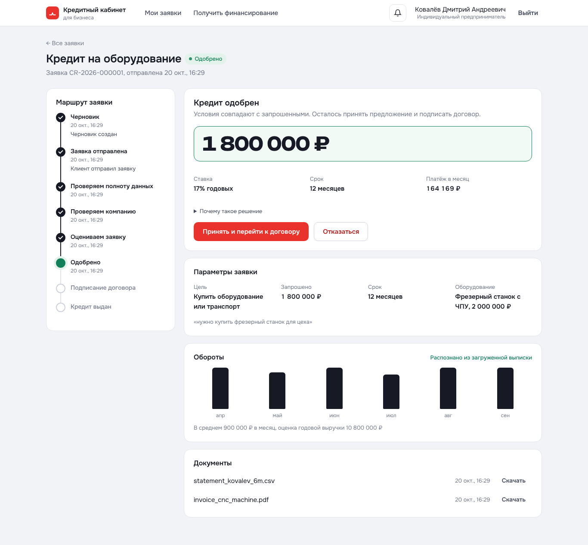
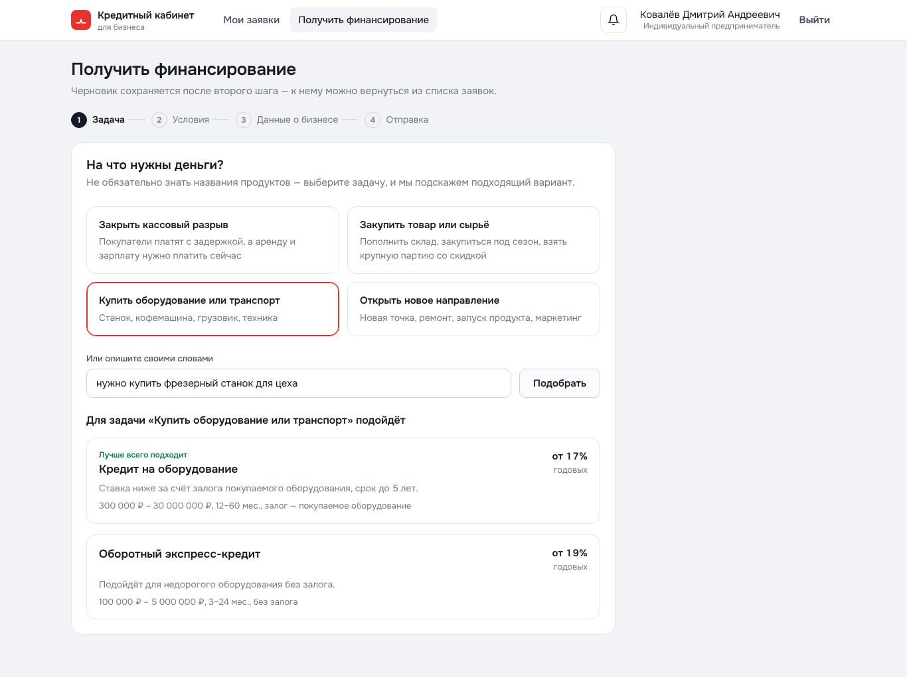
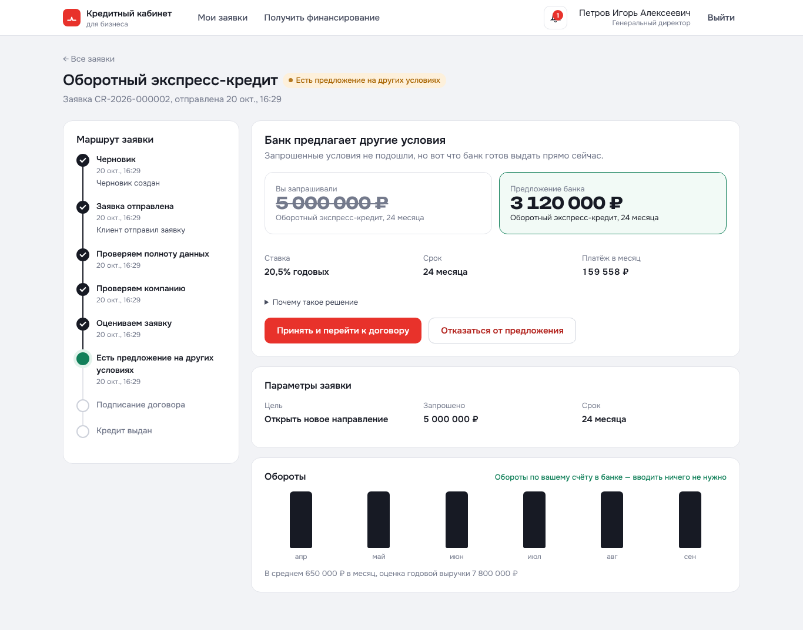
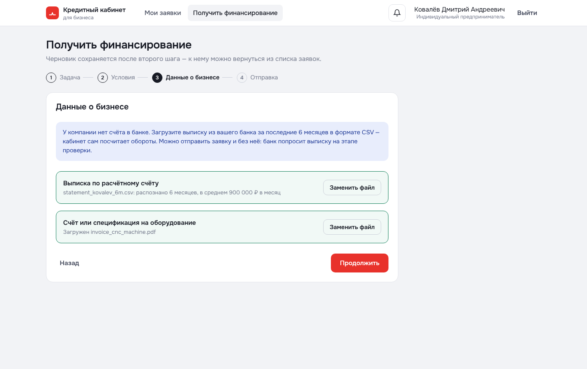
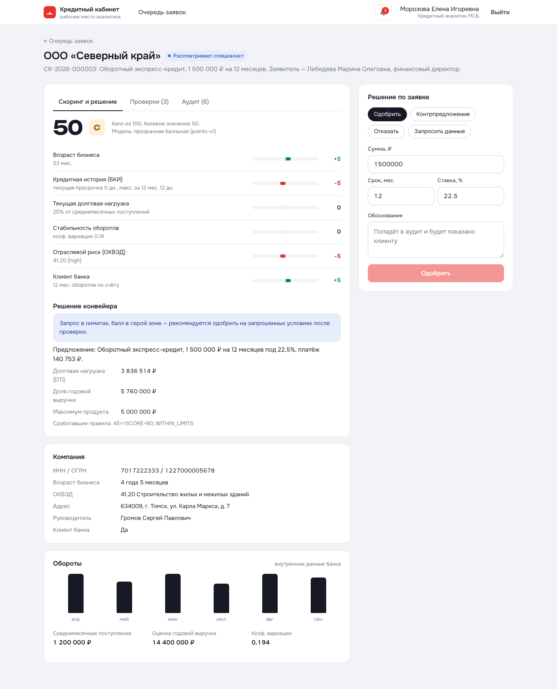
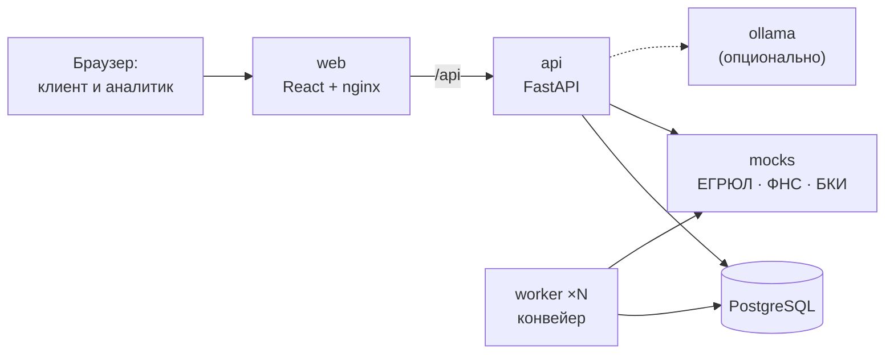

# Умный кредитный кабинет предпринимателя

Команда: [доска задач](https://github.com/users/Makasinnnnnn/projects/4) · [общий контекст и правила](docs/team/README.md) · [стратегия](docs/team/STRATEGY.md).

Исходный прототип импортирован из командного архива (commit `6ddf3c027d1103911990f16b446a62161bfd3bd2`). Скриншоты ниже относятся к исходной версии; актуальные проверки фиксируются отдельно в документации команды.

Прототип цифрового кредитного конвейера для малого и микробизнеса — решение кейса Альфа-Банка на хакатоне «Альфа-Будущее».

Предприниматель выбирает, **на что** нужны деньги, а не продукт по названию. Кабинет подбирает кредит, сам подтягивает реквизиты из реестра и обороты по счёту, отправляет заявку в конвейер и показывает, на каком этапе она сейчас. Банк в том же продукте проверяет компанию в ЕГРЮЛ/ЕГРИП, ФНС и БКИ, считает прозрачный скоринг, принимает решение — одобрение, контрпредложение, дозапрос, ручное рассмотрение или отказ — и доводит заявку до подписания договора и выдачи (симуляция).



| | |
|---|---|
|  |  |
|  |  |

## Быстрый старт

Требования: Docker 24+ с Compose v2, 4 ГБ свободной памяти, свободные порты 8080 и 8000.

```bash
git clone https://github.com/Makasinnnnnn/AlphaFutureHackaton.git
cd AlphaFutureHackaton
docker compose up --build
```

Первая сборка занимает 2–4 минуты. Когда все сервисы станут `healthy`:

- **Интерфейс:** http://localhost:8080
- **Swagger:** http://localhost:8080/api/docs

Настройки по умолчанию подходят для проверки, `.env` не обязателен. Чтобы изменить, скопируйте `.env.example` в `.env`.

Остановить: `docker compose down`. Сбросить данные: `docker compose down -v`.

## Тестовые учётные записи

На странице входа учётки показаны списком — вход в один клик. Пароль у всех: `demo2026`.

| Email | Компания | Сценарий |
|---|---|---|
| anna@demo.ru | ИП Смирнова (кофейни «Зерно») | Клиент банка, чистая история → автоматическое одобрение → подписание → выдача |
| start@demo.ru | ООО «Новый старт» (IT) | Бизнесу 10 месяцев, просит больше, чем позволяет выручка → контрпредложение |
| kovalev@demo.ru | ИП Ковалёв (столярная мастерская) | Не клиент банка, кредит на оборудование → дозапрос выписки и счёта → распознавание → одобрение |
| sever@demo.ru | ООО «Северный край» (строительство) | Пограничный балл → ручное рассмотрение аналитиком |
| vector@demo.ru | ООО «Вектор Логистик» | Текущая просрочка 47 дней → отказ по стоп-фактору |
| zakat@demo.ru | ООО «Закат» | Ликвидирована по ЕГРЮЛ → отказ до скоринга |
| tikhonova@demo.ru | ИП Тихонова (магазин одежды) | БКИ недоступно → повторы → передача специалисту |
| analyst@demo.ru | — | Кредитный аналитик: очередь, скоринг, проверки, аудит, решения |

Файлы для загрузки: `test-data/statement_kovalev_6m.csv` (выписка), `test-data/invoice_cnc_machine.pdf` (счёт), `test-data/statement_too_short.csv` (выписка за 2 месяца — проверка предупреждения).

## Сценарий проверки за 5 минут

1. Войдите как **anna@demo.ru** → «Получить финансирование» → «Закупить товар или сырьё» → «Оборотный экспресс-кредит» → 2 000 000 ₽, 12 мес. → «Сохранить и продолжить» → «Продолжить» → согласие → «Отправить заявку». Маршрут заявки обновляется сам; через 6–10 секунд — «Кредит одобрен». Примите предложение, подпишите договор — статус «Кредит выдан», график платежей.
2. Выйдите, войдите как **kovalev@demo.ru** → «Купить оборудование или транспорт» → «Кредит на оборудование» → 1 800 000 ₽, 36 мес. → отправьте без документов. Статус «Нужна дополнительная информация». Укажите оборудование и стоимость 2 000 000 ₽, загрузите выписку и счёт из `test-data/` — обороты распознаются автоматически. «Отправить повторно» → одобрено под 17%.
3. Войдите как **sever@demo.ru**, подайте «Оборотный экспресс-кредит» на 1 500 000 ₽ → «Рассматривает специалист».
4. Войдите как **analyst@demo.ru** → «Ждут решения» → заявка «Северного края»: балл 50, вклад факторов, лимиты, ответы ЕГРЮЛ/ФНС/БКИ, аудит. Сделайте контрпредложение на 1 200 000 ₽ с обоснованием.
5. Вернитесь в **sever@demo.ru** — предложение с комментарием специалиста.

Все сценарии с ожидаемыми результатами — [docs/test-scenarios.md](docs/test-scenarios.md). Автоматическая проверка работающей системы: `python scripts/e2e_check.py --base http://localhost:8080`.

## Архитектура



- **web** — React 19 + TypeScript, раздаётся nginx, который проксирует `/api` на бэкенд.
- **api** — FastAPI: REST, JWT, роли, state machine, аудит. При старте применяет миграции и загружает справочники и синтетические данные.
- **worker** — автоматические этапы конвейера: проверка полноты, обогащение, скоринг, решение. Масштабируется (`--scale worker=3`) благодаря `FOR UPDATE SKIP LOCKED`.
- **db** — PostgreSQL 16: заявки, аудит, проверки, документы, уведомления.
- **mocks** — симулятор внешних источников с возможностью имитировать задержки и сбои.
- **ollama** — опциональная open-weights модель для подбора продукта по свободному тексту.

Подробно: [архитектура и нефункциональные требования](docs/architecture.md) · [диаграмма состояний заявки](docs/state-machine.md) · [модель данных](docs/data-model.md) · [скоринг и кредитное решение](docs/scoring.md) · [API](docs/api.md) · [продуктовое обоснование и MVP](docs/product.md)

## Кредитный процесс

```
Задача → Продукт → Черновик → Отправка → Проверка полноты ─┬→ Дозапрос → (клиент дополняет) ─┐
                                                           └→ Обогащение (ЕГРЮЛ, ФНС, БКИ) ←───┘
   → Скоринг → Решение: одобрено | контрпредложение | ручное рассмотрение | отказ
   → Принятие → Договор и график → Подписание (симуляция) → Выдача (симуляция)
```

- **Скоринг** — прозрачная балльная модель: возраст бизнеса, кредитная история, долговая нагрузка, стабильность оборотов, отрасль, налоговые признаки. Стоп-факторы: ликвидация, дисквалификация руководителя, текущая просрочка более 30 дней.
- **Решение** — отдельный слой правил продукта: пороги баллов, лимиты по выручке и долговой нагрузке, залог, минимальный возраст бизнеса. Небинарный результат: та же сумма на больший срок, меньшая сумма или другой продукт.
- **Клиент** видит причины простыми словами, **аналитик** — веса, лимиты, сработавшие правила и ответы источников.

## Требования к окружению

| Режим | Что нужно |
|---|---|
| Docker (основной) | Docker 24+ с Compose v2 |
| Локальная разработка | Python 3.12, Node.js 22, PostgreSQL 16 |

Версии зафиксированы: `backend/requirements.lock.txt` и `mocks/requirements.lock.txt` (с хешами), `frontend/package-lock.json`, теги Docker-образов в Dockerfile.

## Конфигурация

Все параметры — переменные окружения (см. `.env.example`).

| Переменная | По умолчанию | Назначение |
|---|---|---|
| `POSTGRES_USER` / `POSTGRES_PASSWORD` / `POSTGRES_DB` | `conveyor` | Доступ к БД |
| `JWT_SECRET` | демо-значение | Ключ подписи токенов — **сменить вне демо** |
| `ENVIRONMENT` | `demo` | `production` отключает выдачу тестовых учёток через API |
| `WEB_PORT` / `API_PORT` | `8080` / `8000` | Порты на хосте |
| `PIPELINE_STEP_DELAY_SEC` | `1.5` | Пауза между этапами конвейера, чтобы движение было видно в интерфейсе (в продакшене 0) |
| `MOCK_FAILURE_RATE` | `0` | Доля случайных отказов внешних источников (0..1) |
| `MOCK_LATENCY_MS` | `150` | Задержка ответа источников |
| `LLM_ENABLED` | `false` | Включить подбор продукта с помощью open-weights модели |
| `OLLAMA_MODEL` | `qwen2.5:1.5b` | Модель Ollama (Apache-2.0) |
| `LOG_LEVEL` | `INFO` | Уровень логов (JSON) |

Дополнительно для бэкенда: `INTEGRATION_TIMEOUT_SEC` (3), `INTEGRATION_RETRIES` (3), `PIPELINE_MAX_ENRICHMENT_ATTEMPTS` (3), `MAX_UPLOAD_BYTES` (5 МБ) — см. `backend/app/config.py`.

### Опциональный ИИ-ассистент

```bash
LLM_ENABLED=true docker compose --profile ai up --build -d
docker compose exec ollama ollama pull qwen2.5:1.5b
```

Без модели и при любом её сбое подбор работает на правилах — основной сценарий от ИИ не зависит.

## Разработка без Docker

```bash
# PostgreSQL 16 должен быть запущен, БД conveyor / пользователь conveyor
cd backend
python3.12 -m venv .venv && . .venv/bin/activate
pip install --require-hashes -r requirements.lock.txt && pip install -r requirements-dev.lock.txt
alembic upgrade head && python -m app.seed
uvicorn app.main:app --reload --port 8000        # API
python -m app.worker                              # воркер, в отдельном терминале
cd ../mocks && uvicorn app:app --port 8001        # симулятор источников
cd ../frontend && npm ci && npm run dev           # интерфейс на http://localhost:5173
```

## Тесты

```bash
cd backend && pytest -q          # 41 тест: доменная логика + сквозные сценарии через API на PostgreSQL
cd frontend && npm run typecheck
python scripts/e2e_check.py      # сквозная проверка работающей системы, все 7 персон
```

## Документация для проверки

| Что требует кейс | Где |
|---|---|
| Архитектурная схема | [docs/architecture.md](docs/architecture.md) |
| Описание API | [docs/api.md](docs/api.md) |
| OpenAPI/Swagger | [docs/api/openapi.json](docs/api/openapi.json), живой Swagger — `/api/docs` |
| Коллекция запросов | [docs/api/postman_collection.json](docs/api/postman_collection.json) |
| Диаграмма состояний заявки | [docs/state-machine.md](docs/state-machine.md) |
| Модель данных | [docs/data-model.md](docs/data-model.md) |
| Тестовые сценарии | [docs/test-scenarios.md](docs/test-scenarios.md) |
| Синтетические данные и учётки | `data/synthetic/`, `test-data/`, раздел «Тестовые учётные записи» |
| Сторонние компоненты и смоделированные интеграции | [THIRD_PARTY_NOTICES.md](THIRD_PARTY_NOTICES.md) |

## Допущения

- Внешние источники (ЕГРЮЛ/ЕГРИП, ФНС, БКИ) — локальные симуляторы с упрощёнными контрактами. Все данные синтетические.
- Подписание — подтверждение в кабинете с хешем условий договора, без реальной электронной подписи. Выдача — запись о зачислении без реальных операций.
- Выручка оценивается по поступлениям на расчётный счёт.
- Веса скоринга экспертные, не обучены на исторических данных.
- Все уведомления — внутри кабинета, без email и SMS (условие кейса).

Полный список с обоснованием и планом развития — [docs/product.md](docs/product.md).

## Версия для проверки

Версия на момент дедлайна отмечена тегом `v1.0-submission` (commit hash указывается в форме сдачи).

### UI fonts and design corrections

The UI uses Styrene UI from the official URLs published by Alfa Laboratory.
`npm run dev` and `npm run build` prepare the three WOFF2 weights automatically
via `frontend/scripts/prepare-fonts.mjs`. First preparation requires build-time
network access to `alfabank.gcdn.co`; subsequent builds reuse valid local files
in `frontend/public/fonts`. The finished application loads fonts locally and
requires no font CDN. Use is based on the hackathon permission stated by the team.

To rebuild the edited UI when port 8080 is occupied:

```sh
WEB_PORT=8081 docker compose up -d --build web
```

Design decisions and verification limits: [DESIGN_GUIDELINES](docs/DESIGN_GUIDELINES.md).
