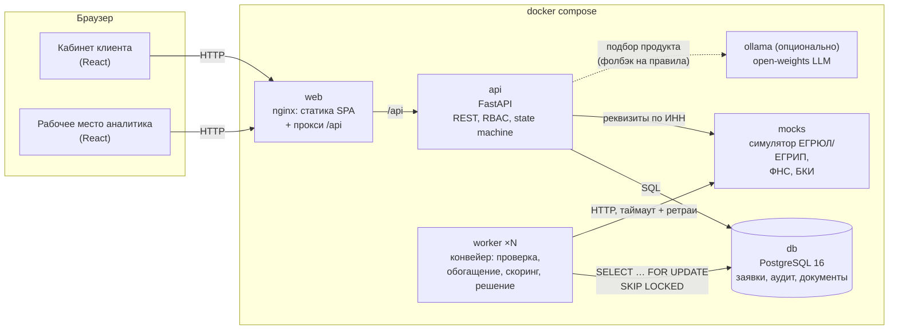
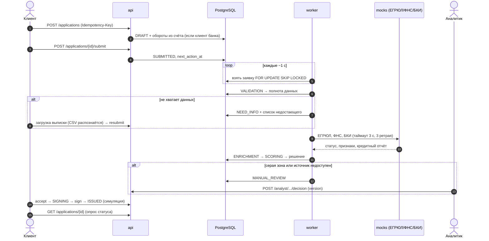

# Архитектура

## Компоненты



| Компонент | Технология | Ответственность |
|---|---|---|
| `web` | React 19 + TypeScript, Vite, nginx | Кабинет клиента и аналитика. Один origin с API (nginx проксирует `/api`), CORS в демо не нужен. |
| `api` | Python 3.12, FastAPI, SQLAlchemy 2, Alembic | REST API, аутентификация (JWT), ролевая модель, валидация, все переходы статусов через state machine, аудит, уведомления. При старте — миграции и загрузка справочников. |
| `worker` | тот же образ, `python -m app.worker` | Автоматические этапы конвейера. Забирает заявки через `FOR UPDATE SKIP LOCKED`, поэтому реплик может быть сколько угодно. |
| `db` | PostgreSQL 16 | Единственное хранилище состояния: заявки (JSONB для гибких частей), аудит-лог, результаты проверок, документы, уведомления. |
| `mocks` | FastAPI | Симулятор внешних источников с упрощёнными, но осмысленными контрактами. Умеет имитировать задержки и сбои. |
| `ollama` | Ollama + Qwen2.5 1.5B (open weights, Apache-2.0) | Опциональная классификация свободного описания задачи. Профиль `ai`, по умолчанию выключен. |

## Как заявка проходит через систему



## Ключевые решения и их причины

**Модульный монолит + отдельный воркер, а не микросервисы.** Для MVP это дешевле в разработке и эксплуатации, при этом границы модулей уже выделены: `domain/` (чистая бизнес-логика без зависимостей от БД и HTTP), `services/` (сценарии), `integrations/` (внешние источники), `api/` (транспорт). Вынести скоринг или интеграции в отдельный сервис можно без переписывания доменной логики.

**Асинхронный конвейер через БД вместо брокера сообщений.** Состояние заявки и есть очередь: воркер выбирает заявки, у которых наступило `next_action_at`. `SKIP LOCKED` даёт конкурентную обработку без дублей, транзакция на каждый шаг — атомарность «сменить статус + записать аудит + уведомить». Для текущих объёмов это надёжнее и проще, чем Kafka/RabbitMQ. Переход на брокер — в разделе «Развитие».

**State machine — единственная точка смены статуса.** Все переходы описаны таблицей `(из, в) → кто может` в `app/domain/statuses.py`. Недопустимый переход — `409`, каждый допустимый пишется в `application_events`.

**Скоринг и кредитное решение разделены.** Скоринг оценивает профиль заёмщика, решение учитывает продукт, сумму, срок, лимиты и залог. Это прямо следует из кейса: одинаковый балл даёт разные решения по разным продуктам.

**Оптимистическая блокировка.** У заявки есть `version`; аналитик присылает версию, которую видел. Если заявка изменилась — `409`, а не тихая перезапись.

**Документы в БД.** Для прототипа файлы до 5 МБ хранятся в `bytea` с SHA-256. В продакшене — объектное хранилище (S3-совместимое) с антивирусной проверкой; интерфейс сервиса документов это позволяет.

## Нефункциональные требования

| Требование | Как обеспечено |
|---|---|
| Безопасность | JWT (HS256, срок жизни 8 ч), bcrypt для паролей, RBAC на каждом эндпоинте, изоляция данных клиентов (чужая заявка — 404), валидация входных данных (Pydantic), белый список типов и размер файлов, заголовки `X-Content-Type-Options`/`X-Frame-Options`, секреты через переменные окружения, контейнеры от непривилегированного пользователя, клиенту не раскрываются веса скоринга и правила. |
| Надёжность | Транзакция на каждый шаг конвейера, идемпотентное создание и отправка заявки, оптимистическая блокировка, таймауты и экспоненциальные ретраи к внешним источникам, повтор этапа обогащения с откладыванием, передача специалисту, если источник так и не ответил. Сбой одной заявки не останавливает воркер. |
| Отказоустойчивость | Healthchecks всех сервисов, `restart: unless-stopped`, readiness-проба проверяет БД и источники. Карточка компании показывается из последних сохранённых данных, если реестр недоступен. |
| Масштабирование | API без состояния (`--workers`, реплики за балансировщиком), воркеры масштабируются `--scale worker=N`, индексы на `(status, next_action_at)`. |
| Сопровождение | Миграции Alembic, зафиксированные версии зависимостей (lock-файлы с хешами), структурированные JSON-логи с `request_id`, OpenAPI из кода, 41 автотест, чистая доменная логика без побочных эффектов. |
| Наблюдаемость | Аудит-лог по каждой заявке, лог интеграций с длительностью и номером попытки, метрики конвейера (`/api/analyst/stats`: доля одобрений, среднее время до решения). |

## Структура репозитория

```
backend/
  app/
    domain/         чистая бизнес-логика: статусы, скоринг, решение, финансы, распознавание выписки
    services/       сценарии: заявки, конвейер, представления, ассистент
    integrations/   HTTP-клиент внешних источников (таймауты, ретраи)
    api/routes.py   REST API
    main.py         приложение, middleware, обработка ошибок
    worker.py       воркер конвейера
    seed.py         справочники и синтетические данные
  alembic/          миграции БД
  tests/            юнит- и интеграционные тесты
mocks/              симулятор ЕГРЮЛ/ФНС/БКИ
frontend/           React-приложение и конфигурация nginx
data/synthetic/     синтетические компании (генерируются скриптом)
test-data/          выписки и счёт для ручной проверки
scripts/            генерация данных, экспорт OpenAPI, e2e-проверка
docs/               документация, OpenAPI, Postman, скриншоты
```
