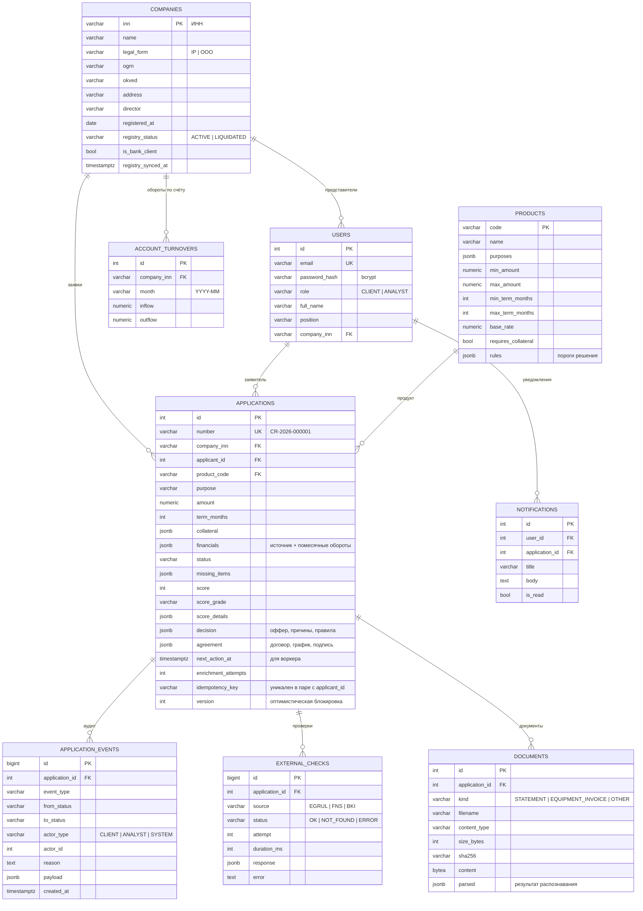

# Модель данных

PostgreSQL 16. Схема создаётся миграциями Alembic (`backend/alembic/versions`). Гибкие части заявки (обороты, залог, решение, договор, детализация скоринга) хранятся в JSONB — их структура меняется чаще, чем ядро заявки, и не требует миграций на каждое изменение правил.



## Индексы и ограничения

| Объект | Зачем |
|---|---|
| `ix_applications_pipeline (status, next_action_at)` | Быстрый выбор заявок воркером. |
| `uq_application_idempotency (applicant_id, idempotency_key)` | Повтор `POST /applications` с тем же ключом не создаёт дубль. |
| `applications.version` | Оптимистическая блокировка (SQLAlchemy `version_id_col`). |
| `account_turnovers (company_inn, month)` UNIQUE | Один ряд оборотов на месяц. |
| Индексы по внешним ключам | Карточка заявки собирается за несколько запросов `selectin`. |

## Структуры JSONB

**`financials`**
```json
{
  "source": "BANK_ACCOUNT | STATEMENT_UPLOAD",
  "months": [{"month": "2026-04", "inflow": 990000, "outflow": 760000}],
  "months_count": 6,
  "avg_monthly_inflow": 900000,
  "annual_revenue_estimate": 10800000,
  "stability_cv": 0.14
}
```

**`decision`**
```json
{
  "outcome": "COUNTER_OFFER",
  "offer": {"product_code": "WORKING_CAPITAL", "amount": 3120000, "term_months": 24, "rate": 20.5, "monthly_payment": 159558.0},
  "reasons": [{"impact": "negative", "text": "Сумма великовата относительно выручки бизнеса."}],
  "limits": {"product_max": 5000000, "revenue": 3120000, "dti": 6355055},
  "rules_fired": ["LIMIT:revenue", "COUNTER"],
  "decided_by": "SYSTEM"
}
```
Клиент получает только `outcome`, `offer`, `reasons` и комментарий аналитика. `limits`, `rules_fired` и `score_details` доступны только аналитику.
