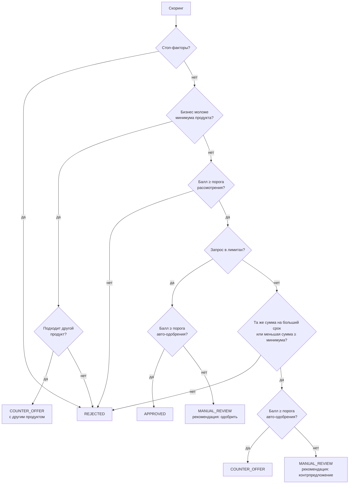

# Скоринг и кредитное решение

Это два разных слоя, как и требует кейс (стр. 14–15):

1. **Скоринг** (`app/domain/scoring.py`) оценивает риск заёмщика: возраст бизнеса, кредитную историю, обороты, отрасль, налоговые признаки. Параметры конкретной заявки на него не влияют.
2. **Кредитное решение** (`app/domain/decision.py`) применяет правила продукта к скорингу и параметрам заявки: сумма, срок, лимиты по выручке и долговой нагрузке, залог.

Поэтому одинаковый балл даёт разные решения по разным продуктам. Например, у ООО «Северный край» балл 50: по оборотному кредиту это ручное рассмотрение, по овердрафту — отказ (проверяется тестом `test_same_score_different_products_give_different_decisions`).

Модель намеренно простая и прозрачная — балльная, без ML. Так её можно объяснить клиенту и аналитику, проверить тестами и откалибровать на исторических данных банка, когда они появятся.

## Скоринг: балльная модель points-v1

Шкала 0–100, выше — ниже риск. База — 50 баллов.

| Фактор | Источник | Условие → баллы |
|---|---|---|
| Возраст бизнеса | ЕГРЮЛ/ЕГРИП | < 6 мес. −20; 6–12 мес. −10; 1–3 года 0; 3–5 лет +5; ≥ 5 лет +10 |
| Кредитная история | БКИ | текущая просрочка > 30 дн. −30; текущая просрочка −20; просрочки > 30 дн. за год −10; небольшие просрочки за год −5; чистая история +10; истории нет 0 |
| Текущая долговая нагрузка | БКИ + обороты | платежи / поступления: < 10% +5; < 30% 0; < 50% −10; ≥ 50% −20 |
| Стабильность оборотов | счёт в банке или выписка | коэффициент вариации: < 0,15 +10; < 0,30 0; ≥ 0,30 −10 |
| Отраслевой риск | ОКВЭД | низкий (IT, медицина, образование…) +5; средний 0; высокий (строительство, недвижимость…) −5 |
| Адрес массовой регистрации | ФНС | −10 |
| Налоговая задолженность | ФНС | −15 |
| Клиент банка | внутренние данные | ≥ 6 мес. оборотов по счёту +5 |

Грейд: A ≥ 75, B ≥ 60, C ≥ 45, D < 45.

**Стоп-факторы** — отказ независимо от балла: компания ликвидирована или в ликвидации, руководитель дисквалифицирован, текущая просрочка больше 30 дней.

## Кредитное решение

Правила продукта хранятся в `products.rules` (JSONB) и меняются без изменения кода:

| Правило | Оборотный кредит | Кредит на оборудование | Овердрафт |
|---|---|---|---|
| Авто-одобрение, балл ≥ | 60 | 60 | 70 |
| Рассмотрение, балл ≥ | 45 | 40 | 55 |
| Минимальный возраст бизнеса | 6 мес. | 12 мес. | 6 мес. |
| Лимит по выручке | 40% годовой | 80% годовой | 30% среднемесячного оборота |
| Долговая нагрузка (все платежи / поступления) | ≤ 50% | ≤ 60% | ≤ 50% |
| Залог | — | ≤ 90% стоимости оборудования | — |
| Базовая ставка | 19% | 17% | 21% |

Надбавка к ставке по грейду: A +0, B +1,5, C +3,5, D +6 п. п.

Порядок правил:

Сначала система пытается сохранить сумму и увеличить срок — так меньше платёж. Если не получается, предлагает максимальную доступную сумму (округление вниз до 10 000 ₽).

## Объяснимость

- **Клиент** видит список причин простыми словами («Обороты стабильные», «Сумма великовата относительно выручки бизнеса»), но не веса и не пороги — иначе модель легко «подогнать».
- **Аналитик** видит балл, вклад каждого фактора, исходные значения, рассчитанные лимиты, сработавшие правила и ответы источников.

## Синтетические персоны и ожидаемые исходы

| Компания | Учётка | Ключевые данные | Балл | Исход |
|---|---|---|---|---|
| ИП Смирнова (кофейни) | anna@demo.ru | 7,5 года, чистая история, 2 млн/мес стабильно | 90 A | `APPROVED` → `ISSUED` |
| ООО «Новый старт» (IT) | start@demo.ru | 10 мес., 650 тыс./мес, просит 5 млн | 65 B | `COUNTER_OFFER` 3,12 млн (лимит 40% выручки); на оборудование — альтернативный продукт |
| ИП Ковалёв (столярка) | kovalev@demo.ru | клиент банка без доступной истории оборотов, 6 лет | 85 A | `NEED_INFO` (выписка, счёт) → `APPROVED` |
| ООО «Северный край» (стройка) | sever@demo.ru | просрочка 12 дн. за год, высокий отраслевой риск | 50 C | `MANUAL_REVIEW` → решение аналитика |
| ООО «Вектор Логистик» | vector@demo.ru | текущая просрочка 47 дн., налоговый долг | 25 D | `REJECTED` (стоп-фактор) |
| ООО «Закат» | zakat@demo.ru | ликвидирована по ЕГРЮЛ | — | `REJECTED` до скоринга |
| ИП Тихонова (одежда) | tikhonova@demo.ru | БКИ отвечает 503 | — | ретраи → `MANUAL_REVIEW` |

## Ограничения модели

- Веса экспертные, а не обученные. На реальных данных нужно калибровать по дефолтам (Gini/ROC AUC, PSI для стабильности), как банки делают для внутренних рейтинговых моделей.
- Выручка оценивается по поступлениям на счёт — это приближение: в поступления могут попадать займы и переводы между своими счетами. В развитии — классификация операций выписки.
- Нет учёта группы связанных компаний и поручителей.
