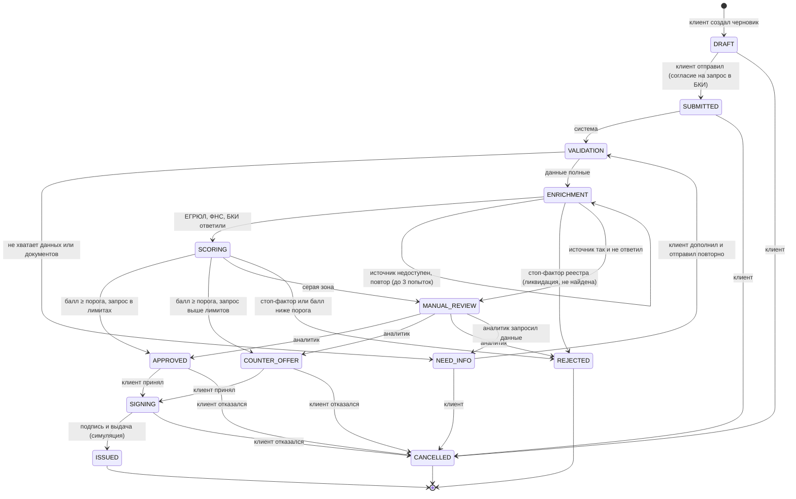

# Диаграмма состояний заявки

Ручной дозапрос `ANALYST_REQUEST` фиксирует снимок ID документов. `RESUBMIT` без нового документа возвращает 409; с новым документом возвращает заявку из NEED_INFO в MANUAL_REVIEW, где специалист проверяет содержание. Автоматический пересчёт не заменяет ручное рассмотрение. Каждый повторный запрос создаёт новый снимок, поэтому старый ответ не выполняет следующий запрос.

Технические ошибки автоматического этапа ограничены `PIPELINE_MAX_ERROR_ATTEMPTS` (по умолчанию 3); между попытками действует `PIPELINE_ERROR_RETRY_DELAY_SEC` (10 секунд). При исчерпании попыток заявка переходит в MANUAL_REVIEW. Перед запуском требуется миграция 0002.

Источник истины — `backend/app/domain/statuses.py`. Любой переход, которого нет в таблице ниже, возвращает `409 INVALID_TRANSITION`. Каждый переход пишется в аудит-лог (`application_events`) с указанием, кто его выполнил и почему.

## Таблица переходов

| Из | В | Кто | Условие |
|---|---|---|---|
| — | `DRAFT` | Клиент | Создание заявки. Для клиентов банка обороты подставляются из счёта. |
| `DRAFT` | `SUBMITTED` | Клиент | Параметры в лимитах продукта, есть согласие на запрос в БКИ. Повторный вызов идемпотентен. |
| `SUBMITTED` | `VALIDATION` | Система | Воркер взял заявку в работу. |
| `VALIDATION` | `NEED_INFO` | Система | Нет оборотов минимум за 3 месяца; для кредита на оборудование — нет описания, стоимости или счёта. |
| `VALIDATION` | `ENRICHMENT` | Система | Данные полные. |
| `NEED_INFO` | `VALIDATION` | Клиент | Клиент дополнил данные. Сумму, срок и продукт на этом этапе менять нельзя. |
| `ENRICHMENT` | `SCORING` | Система | Все три источника ответили. |
| `ENRICHMENT` | `REJECTED` | Система | Компания не найдена в ЕГРЮЛ/ЕГРИП или ликвидирована. Скоринг не запускается. |
| `ENRICHMENT` | `MANUAL_REVIEW` | Система | Источник не ответил после 3 попыток этапа (каждая — с 3 HTTP-ретраями). |
| `SCORING` | `APPROVED` | Система | Нет стоп-факторов, балл ≥ порога авто-одобрения продукта, запрос в лимитах. |
| `SCORING` | `COUNTER_OFFER` | Система | Балл ≥ порога, но запрос выше лимита: та же сумма на больший срок, меньшая сумма или другой продукт. |
| `SCORING` | `MANUAL_REVIEW` | Система | Балл между порогом рассмотрения и порогом авто-одобрения. |
| `SCORING` | `REJECTED` | Система | Стоп-фактор, балл ниже порога рассмотрения или доступная сумма меньше минимума продукта. |
| `MANUAL_REVIEW` | `APPROVED` / `COUNTER_OFFER` / `REJECTED` / `NEED_INFO` | Аналитик | С обоснованием и актуальной версией заявки. |
| `APPROVED`, `COUNTER_OFFER` | `SIGNING` | Клиент | Клиент принял условия, формируется договор и график. |
| `SIGNING` | `ISSUED` | Клиент | Подтверждение и подпись (симуляция ПЭП), выдача (симуляция). |
| `DRAFT`, `SUBMITTED`, `NEED_INFO`, `APPROVED`, `COUNTER_OFFER`, `SIGNING` | `CANCELLED` | Клиент | Отмена или отказ от предложения. |

Терминальные статусы: `ISSUED`, `REJECTED`, `CANCELLED` — выходов из них нет (проверяется тестом).

## Что видит клиент на каждом статусе

| Статус | Заголовок | Что от клиента нужно |
|---|---|---|
| `DRAFT` | Черновик | Проверить параметры и отправить |
| `SUBMITTED` | Заявка отправлена | Ничего, статус обновится сам |
| `VALIDATION` | Проверяем полноту данных | Ничего |
| `NEED_INFO` | Нужна дополнительная информация | Дополнить по списку и отправить повторно |
| `ENRICHMENT` | Проверяем компанию | Ничего |
| `SCORING` | Оцениваем заявку | Ничего |
| `MANUAL_REVIEW` | Рассматривает специалист | Ничего, решение придёт в кабинет |
| `APPROVED` | Одобрено | Принять предложение |
| `COUNTER_OFFER` | Есть предложение на других условиях | Сравнить и принять или отказаться |
| `REJECTED` | Отказ | Посмотреть причины |
| `SIGNING` | Подписание договора | Ознакомиться и подписать |
| `ISSUED` | Кредит выдан | — |
| `CANCELLED` | Заявка отменена | — |

Тексты — в `CLIENT_COPY` в том же файле; интерфейс берёт их из API, поэтому формулировки меняются в одном месте.
